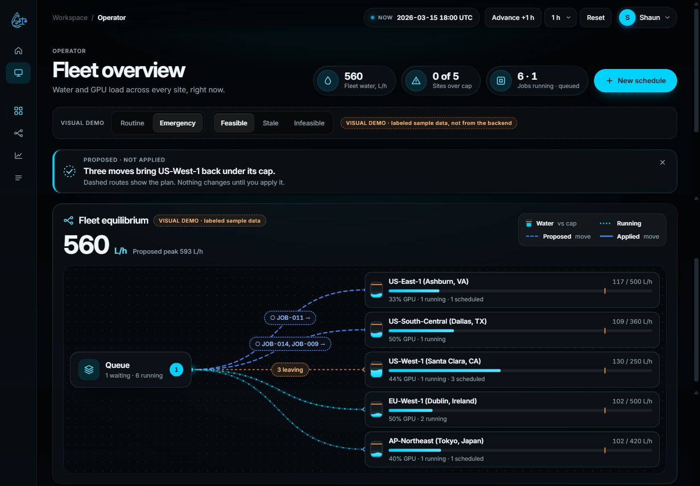
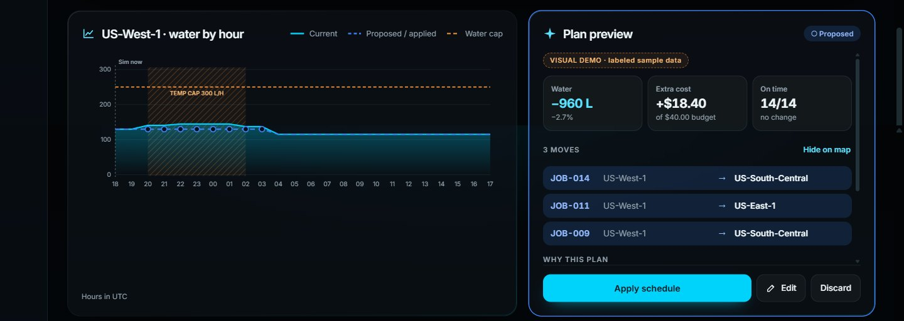
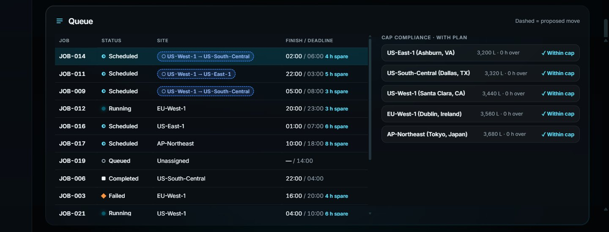
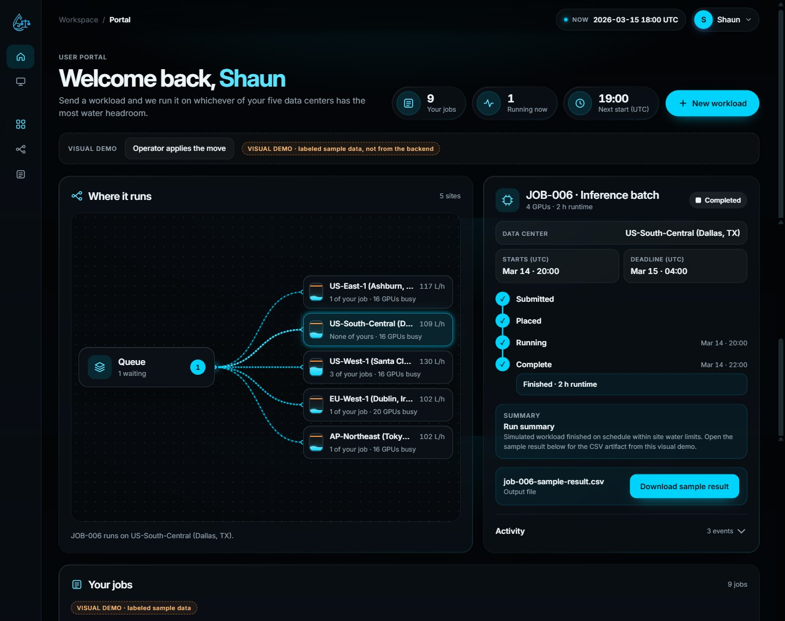
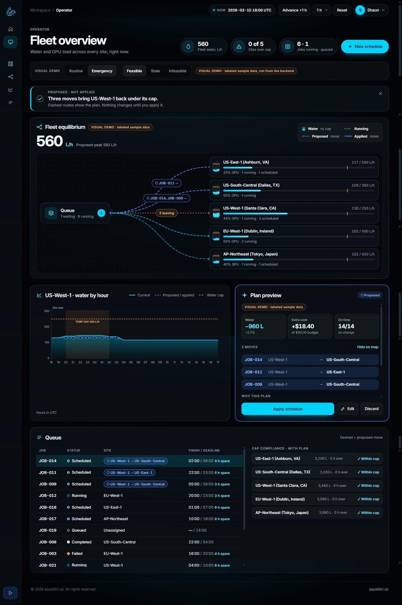
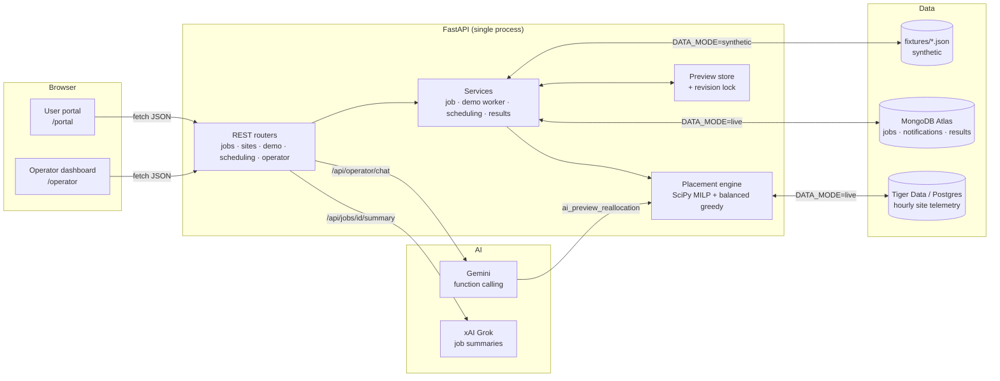
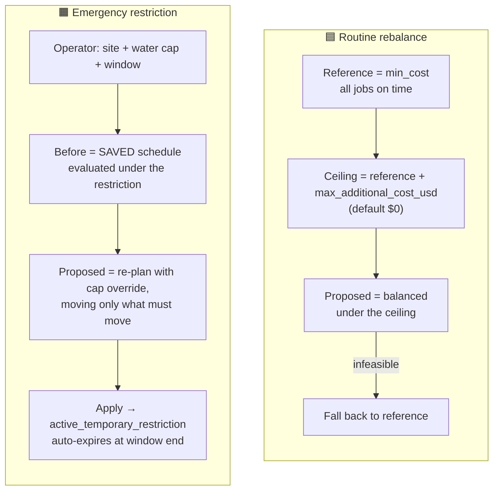
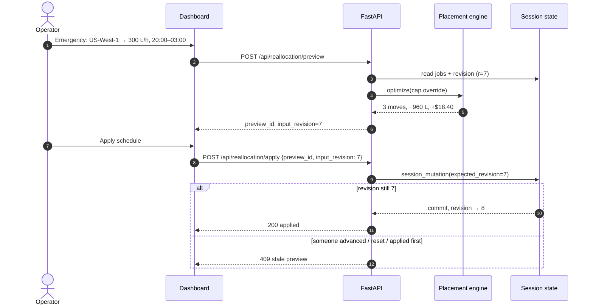
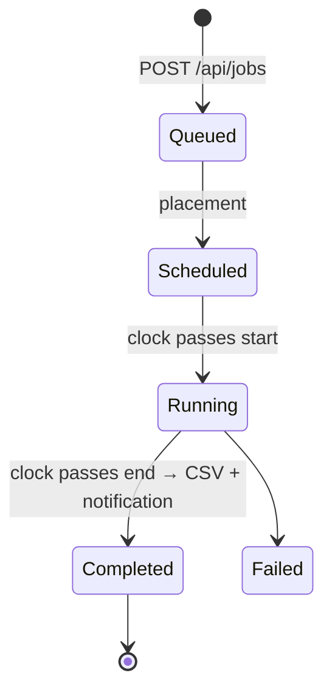

<div align="center">

# 💧 AquaLibri

### Water-aware GPU scheduling for AI data centers

**Every AI job draws water from somewhere. AquaLibri picks the "somewhere."**

It places GPU workloads across a fleet of data centers so that no site goes over its hourly water cap, deadlines are met, and the electricity bill stays as low as possible. When a drought restriction arrives, it shows a re-plan in seconds.

<br/>


-8CAAE6?logo=scipy&logoColor=white)


**Built at HackUTA 2026**

<br/>

| **70× cheaper** | **+22 jobs on time** | **0 cap violations** | **< 10 s** |
|:---:|:---:|:---:|:---:|
| $23,067 → $327 total cost on a 50-job benchmark | 27 → 49 deadlines met | across 5 sites × every hour | worst-case MILP solve |

</div>



---

## Table of contents

- [The problem](#-the-problem)
- [What AquaLibri does](#-what-aqualibri-does)
- [Screenshots](#-screenshots)
- [Benchmark](#-benchmark-run_metricspy)
- [How it works](#-how-it-works)
  - [System architecture](#system-architecture)
  - [The placement engine](#the-placement-engine)
  - [Routine mode vs. emergency mode](#routine-mode-vs-emergency-mode)
  - [Preview → apply, safely](#preview--apply-safely)
  - [The simulated clock](#the-simulated-clock)
  - [AI layer: Gemini and Grok](#ai-layer-gemini-and-grok)
- [The fleet: five real-world WUE profiles](#-the-fleet-five-real-world-wue-profiles)
- [Quick start](#-quick-start)
- [Demo script (3 minutes)](#-demo-script-3-minutes)
- [Data modes](#-data-modes)
- [Configuration](#-configuration)
- [API reference](#-api-reference)
- [Frontend](#-frontend)
- [Testing](#-testing)
- [Project structure](#-project-structure)
- [Troubleshooting](#-troubleshooting)
- [Roadmap](#-roadmap)
- [License](#-license)

---

## 🌊 The problem

Training and serving AI models takes a lot of compute, and the compute is cooled with water. Large data centers often use evaporative cooling. On a hot afternoon a single campus can evaporate millions of liters a day, frequently in regions that are already short on water.

The industry tracks this with **WUE** (Water Usage Effectiveness): liters of water consumed per kWh of IT energy. WUE varies by a factor of 10 across a single fleet:

- Dublin runs on cool outside air at around **0.19 L/kWh**.
- Dallas runs high-temperature evaporative cooling at around **1.90 L/kWh**.

Most schedulers ignore this. They send each job to the cheapest free GPUs, which tends to pile load onto a few sites until those sites hit their water permits. When a utility issues an emergency restriction ("Santa Clara: 300 L/h until 3 AM"), operators find out which jobs are affected by working through spreadsheets.

**AquaLibri treats water as a hard constraint.** Every hour at every site has a water budget, and the scheduler is mathematically barred from exceeding it.

---

## ✨ What AquaLibri does

| | Feature | What it means |
|---|---|---|
| 🧮 | **Exact optimizer** | Binary MILP (SciPy + HiGHS) assigns every job to a `(site, start hour)` slot under per-hour GPU and water caps. Three objectives: `min_cost`, `min_water`, `balanced`. |
| ⚖️ | **Load equilibrium** | A `balanced` mode spreads jobs with a quadratic utilization penalty, so the fleet doesn't pile onto one cheap site. |
| 🚨 | **Emergency re-planning** | Enter a temporary water cap for a site and window. AquaLibri moves only the jobs it has to, shows a before/after comparison, and applies the change in one click. The cap expires on its own. |
| 💸 | **Cost guardrails** | Routine re-plans can only spend up to `max_additional_cost_usd` above the cheapest on-time schedule (default: **$0**). |
| 👀 | **Preview before apply** | Nothing changes until you press Apply. Previews are tied to a revision, so a stale preview returns **409** instead of silently overwriting newer state. |
| ⏩ | **Simulated time** | Advance the clock by 1, 3, or 6 hours. Jobs start, finish, write CSV results, and send notifications deterministically. |
| 🤖 | **Gemini operator assistant** | Type "cap US-West-1 at 115 L/h from 8 PM to noon". Gemini calls the same preview engine through function calling. |
| 📝 | **Grok job summaries** | Each completed job gets a two-sentence operations summary from xAI Grok, based on its real water and cost numbers. |
| 🗄️ | **Two data backends** | `DATA_MODE=synthetic` runs fully offline from fixtures. `DATA_MODE=live` uses MongoDB Atlas for jobs and Tiger Data (Postgres) for site telemetry. |
| 🩺 | **Diagnostics** | 17 typed diagnostic codes (`insufficient_gpus`, `water_cap_restriction`, `profile_gap`, `timezone_naive`, …) explain why a job can't be placed. |
| 🎨 | **Two polished UIs** | A user portal and an operator dashboard with a dark liquid-glass theme, scroll-spy side nav, animated fleet graph and live water chart. No build step. |

---

## 📸 Screenshots

### Operator: fleet equilibrium during an emergency

A temporary 300 L/h cap hits **US-West-1**. Dashed routes show the three proposed moves (JOB-014 and JOB-009 to Dallas, JOB-011 to Ashburn). Each site card shows live water use against its cap and GPU utilization.


### Operator: water by hour and plan preview

The hatched band is the restriction window. The plan preview reports **−960 L** of water at **+$18.40** (out of a $40 budget), with **14/14** jobs still on time. Apply, Edit, or Discard.



### Operator: queue and cap compliance

Every job with its route (old site → new site), finish time versus deadline and spare hours, next to a per-site cap-compliance check for the proposed plan.



### User portal

Send a workload and AquaLibri runs it at whichever site has the most water headroom. Each job shows a step-by-step timeline, a summary, and a downloadable CSV result.



<details>
<summary><b>Full operator page (tall)</b></summary>



</details>

> Screenshots were taken in **visual demo mode** (`?demo=1`). That mode uses clearly labeled sample data and never writes to the backend.

---

## 📊 Benchmark (`run_metrics.py`)

The benchmark uses 50 hard-coded jobs across 5 WUE-calibrated sites, starting at the demo clock anchor (2026-03-15 18:00 UTC). It is reproducible offline:

```bash
python run_metrics.py
```

| Solver | Total cost | On time | Late | Unplaced | Cap violations |
|---|---:|---:|---:|---:|---:|
| Naive "cheapest $/GPU-h first" greedy | **$23,067.14** | 27 | — | 23 | n/a (no water model) |
| **AquaLibri balancer** | **$327.37** | **49** | **0** | **1** | **0** |
| Δ | **−$22,739.77** | **+22** | | **−22** | |

How to read the numbers:

- **The naive solver is expensive because it fails jobs.** It fills the cheapest sites first, runs out of slots, and pays the miss penalty on 23 jobs ($50 to $1,000 each).
- **AquaLibri's $327.37 breaks down as $127.37 of electricity plus $200 for one unplaceable job.** Every other job runs before its deadline.
- **AquaLibri uses more total water (742 vs. 645 L/h combined) because it runs 22 more jobs.** The important property is that every site stays under its hourly cap the whole time, for a total of **27,158 L** over the horizon.
- **Feasibility check:** the same script runs a fleet-wide emergency cap of 1,000 against an aggregate load of 4,332. It correctly reports `infeasible` with slack −3,332 instead of returning a broken plan.

---

## 🧠 How it works

### System architecture



- **One process, no build step.** `uvicorn app.main:app` serves the REST API, the OpenAPI docs, the static CSS and JS, and both HTML pages. Non-API responses get `Cache-Control: no-cache` so UI edits show up immediately.
- **Layered backend:**
  - `api/` holds thin routers.
  - `services/` holds the logic.
  - `repositories/` hides whether data comes from fixtures, Mongo, or Tiger.
  - `schemas/` holds Pydantic v2 contracts.
  - `integrations/` holds the external clients.

### The placement engine

`app/services/placement_engine.py` (~2,100 lines) is the core of the system.

**1. Build candidates.** For every job \(j\) and every eligible site \(s\), it builds each hourly start time \(t\) such that

$$
t \ge \text{earliest\_start}_j \quad\text{and}\quad t + \text{duration}_j \le \text{deadline}_j
$$

The site also needs telemetry for every hour the job would run. Each candidate carries its projected electricity cost and incremental water use.

**2. Slice time atomically.** Already-running jobs become fixed *reservations*. Each site's timeline is cut into atomic slices wherever any candidate or reservation starts or stops, so the constraints are exact rather than approximated to the hour.

**3. Solve a binary MILP.** \(x_{j,s,t} \in \{0,1\}\) means "job \(j\) starts at site \(s\) at time \(t\)", and \(u_j \in \{0,1\}\) means "job \(j\) is left unfulfilled".

$$
\begin{aligned}
\textbf{assignment:}\quad & \sum_{s,t} x_{j,s,t} + u_j = 1 && \forall j \\[4pt]
\textbf{GPUs:}\quad & \sum_{(j,t)\,\text{active in }\tau} g_j\, x_{j,s,t} \;\le\; G_s(\tau) - R^{\text{gpu}}_s(\tau) && \forall s,\ \forall \text{slice } \tau \\[4pt]
\textbf{water:}\quad & W^{\text{fixed}}_s(\tau) + \sum_{(j,t)\,\text{active in }\tau} g_j\, w^{\text{inc}}_s(\tau)\, x_{j,s,t} + R^{\text{water}}_s(\tau) \;\le\; \text{cap}_s(\tau) && \forall s,\ \forall \tau \\[4pt]
\textbf{budget (optional):}\quad & \sum c_{j,s,t}\, x_{j,s,t} + \sum p_j\, u_j \;\le\; C_{\text{ref}} + \Delta_{\max} - C_{\text{running}}
\end{aligned}
$$

where:

- \(g_j\) is the job's GPU count.
- \(G_s\) is the site's GPU capacity, and \(R_s\) is the load already reserved by running jobs.
- \(w^{\text{inc}}_s\) is liters per GPU-hour at that hour.
- \(\text{cap}_s(\tau)\) is the site's hourly cap, or the emergency override if one is active.
- \(p_j\) is the miss penalty.

The objective depends on the mode:

| Objective | Minimizes |
|---|---|
| `min_cost` | electricity \(c_{j,s,t}\) + miss penalties \(p_j\) (+ a small tie-break toward keeping current placements) |
| `min_water` | incremental liters, plus a small electricity tie-break; leaving a job unfulfilled costs \(10^6\) |
| `balanced` | greedy score (below), under the same hard caps |

The solver is SciPy `milp` (HiGHS) with a **10-second time limit**. Results are one of `feasible`, `infeasible`, `solver_error` or `solver_timeout`.

**4. Balanced scoring.** For fleet equilibrium, each placement is scored as

$$
\text{score} = \underbrace{10\,(n_{\text{site}} + 1)^2}_{W_1:\ \text{utilization}} \;+\; \underbrace{1 \cdot \text{cost}_{\$}}_{W_2:\ \text{electricity}} \;+\; \underbrace{0.1 \cdot \text{hours delayed}}_{W_3:\ \text{latency}}
$$

The quadratic term means the fifth job on a site costs much more than the first, which naturally spreads load across the fleet. All hard GPU and water caps still apply.

**5. Cost model.**

$$
\text{electricity}_{\$} = \text{GPUs} \times \text{hours} \times \text{kWh per GPU-hour} \times \$/\text{kWh}_{\text{site,hour}}
$$

Plus the miss penalty for anything unfulfilled. There is no water tariff (`water_usd = 0`), because water is treated as a constraint rather than a price.

**6. Diagnostics.** When a job can't be placed, the engine says why, using one of 17 codes:

| Category | Codes |
|---|---|
| Telemetry | `timezone_naive`, `duplicate_hour`, `profile_gap`, `inconsistent_profile`, `missing_telemetry`, `limited_telemetry_horizon` |
| Placement | `no_eligible_site`, `missing_data_ready`, `data_unavailable_before_deadline`, `insufficient_gpus`, `water_cap_restriction`, `no_feasible_start` |
| Running jobs | `running_missing_assignment`, `running_inconsistent_timestamps`, `running_missing_telemetry`, `running_gpu_overcapacity`, `running_water_cap_exceeded` |

### Routine mode vs. emergency mode



- **Routine** answers "can we get a better-balanced fleet for free, or for at most $X more?". `metrics_before` is the computed cheapest on-time schedule (`computed_reference_schedule`).
- **Emergency** answers "a utility just cut our water, what's the damage and what's the fix?". `metrics_before` is your currently saved schedule left as it is under the new cap (`saved_schedule_under_restriction`), so the delta reflects exactly what the emergency moves change. Jobs with no saved placement use the proposed placement on both sides so they don't distort the delta.
- **Infeasible previews** return `metrics_after: null` rather than made-up zeros.

### Preview → apply, safely



- **Every mutation bumps the revision:** job create, reset, apply, and clock advance.
- **Writes are serialized** by `session_lock.session_mutation(expected_revision)`, a re-entrant lock with an optimistic revision check.
- **The preview store** holds computed previews by id, so Apply commits exactly the plan the operator reviewed.

### The simulated clock

The demo runs on a deterministic clock anchored at **2026-03-15T18:00:00Z**.



- `POST /api/demo/advance {hours}` processes every event in the half-open interval \((t_\text{from}, t_\text{to}]\) in order. Jobs start, jobs finish, each completion writes a **CSV result snapshot**, and a **notification** is sent.
- **Notifications are idempotent.** Each one is keyed `{session}:{job}:e{epoch}`, and Reset bumps the epoch, so replays never duplicate them.
- **Telemetry follows the clock.** `site_time_align` slides site profiles forward when the clock moves past the telemetry horizon, so you can keep advancing without running out of data.
- **The UI keeps dates sensible.** The portal's date picker won't let you choose an earliest start before the current simulated time.

### AI layer: Gemini and Grok

**Gemini operator assistant.** `POST /api/operator/chat`

Gemini is given one tool through `google-generativeai` automatic function calling:

```python
ai_preview_reallocation(site_name, water_cap, start_time, end_time, max_additional_cost_usd)
```

The operator writes in plain English. Gemini extracts the parameters and calls the **same** preview engine the manual form uses. The response includes `assistant_message`, `tool_calls`, and the full `preview`. Gemini never computes a schedule itself; the optimizer does.

**Grok job summaries.** `GET /api/jobs/{id}/summary`

When a job completes, the portal requests a two-sentence operations summary from **xAI `grok-3-mini`**. The prompt is built from `estimate_job_ops_metrics`, which supplies the job's real site, liters and dollars. The integration calls xAI's OpenAI-compatible `/chat/completions` endpoint with plain **httpx** instead of the `openai` SDK. The SDK's compiled `jiter` wheel is blocked by Windows Application Control on locked-down machines, and pure Python avoids that. Errors (missing key, no credits, permission denied) come back as readable messages, and the portal shows "Summary unavailable" instead of breaking.

---

## 🌍 The fleet: five real-world WUE profiles

Sites are generated by `app/demo_sites.py` from published WUE figures. Hourly water caps come from WUE × a 50 MW IT load, shaped by a **diurnal heat curve** (hot afternoons need more cooling water) plus seeded noise (`RNG 20240515`), so every run is reproducible.

| Site | Location | WUE (L/kWh) | Basis | Spec cap (L/h) | Power ($/kWh) |
|---|---|---:|---|---:|---:|
| `us-east-1` | Ashburn, VA | 1.50 | Standard evaporative | 500 | 0.085 |
| `us-south-central` | Dallas, TX | 1.90 | High-temp evaporative | 360 | **0.055** |
| `us-west-1` | Santa Clara, CA | 0.27 | Microsoft 2025 report | **250** | 0.145 |
| `eu-west-1` | Dublin, Ireland | **0.19** | Meta 2024 report | 500 | 0.155 |
| `ap-northeast` | Tokyo, Japan | 1.00 | Mixed cooling | 420 | 0.175 |

These sites pull against each other, which is what makes the scheduling problem interesting:

- **Dallas** has the cheapest power but the worst water efficiency.
- **Dublin** is the most water-efficient but expensive.
- **Santa Clara** has the tightest cap, which makes it the natural target for the emergency demo.

**Job templates:**

| Template | GPUs | Runtime | Miss penalty | Critical |
|---|---:|---:|---:|:---:|
| `inference_batch` | 4 | 2 h | $50 | |
| `training_small` | 8 | 6 h | $200 | |
| `training_large` | 16 | 12 h | $1,000 | ✅ |

---

## 🚀 Quick start

**Requirements:** Python 3.11+. No database or API keys are needed for the default offline mode.

<details open>
<summary><b>Windows (PowerShell)</b></summary>

```powershell
git clone https://github.com/shaun50152/aquilibri.git
cd aquilibri
python -m venv .venv
.\.venv\Scripts\Activate.ps1
pip install -r requirements.txt
Copy-Item .env.example .env
python -m uvicorn app.main:app --reload
```

</details>

<details>
<summary><b>macOS / Linux</b></summary>

```bash
git clone https://github.com/shaun50152/aquilibri.git
cd aquilibri
python3 -m venv .venv
source .venv/bin/activate
pip install -r requirements.txt
cp .env.example .env
python -m uvicorn app.main:app --reload
```

</details>

Then open:

| URL | What |
|---|---|
| http://127.0.0.1:8000/portal | User portal (`/` redirects here) |
| http://127.0.0.1:8000/operator | Operator dashboard |
| http://127.0.0.1:8000/docs | Interactive OpenAPI docs |
| http://127.0.0.1:8000/operator?demo=1 | Visual demo mode: labeled sample data, no backend writes |

---

## 🎬 Demo script (3 minutes)

1. **Portal:** click **New workload**, pick `training_small`, and submit. The fleet graph shows which site it was routed to and why.
2. **Operator:** watch the **Fleet equilibrium** card. Every site shows water against its cap and GPU load.
3. **Advance +1 h** a few times. Jobs go from queued to running to completed, and the portal gets a notification and a downloadable CSV.
4. Open the completed job in the portal. **Grok** writes the operations summary.
5. **New schedule → Emergency.** Cap `US-West-1` at a low value over the evening window and preview it. Dashed routes show the moves, and the water chart shows the hatched restriction band and the new curve under the cap.
6. **Apply schedule.** The restriction becomes active and expires on its own at the end of the window.
7. Ask the **Gemini** assistant the same thing in plain English and compare: same engine, same answer.
8. **Reset** brings everything back to a clean slate (and bumps the revision, so older previews are rejected).

> **Want a bigger price difference?** Restrict `us-east-1` with a cap of 0 over a window covering 19:00–21:00, submit larger (`training_large`) jobs, or use routine mode with a non-zero budget.

---

## 🔀 Data modes

One environment variable switches the backend:

| | `DATA_MODE=synthetic` (default) | `DATA_MODE=live` |
|---|---|---|
| Jobs | `fixtures/jobs.json` (in-memory) | MongoDB Atlas, scoped by `DEMO_SESSION_ID` |
| Sites / telemetry | `fixtures/<SITE_PROFILES_FIXTURE>` | Tiger Data (Postgres), 5 sites × 48 h |
| Network needed | ❌ None | ✅ Atlas + Tiger |
| Empty store | Seeded jobs | Blank slate (no mock data mixed in) |
| Reset | Restores the seeded jobs | Wipes the session's Mongo collections |

Legacy aliases are accepted: `fixtures` means `synthetic` and `mongodb` means `live`. Synthetic mode doubles as a **Wi-Fi fallback**: if hackathon Wi-Fi drops, the demo keeps working.

Seed live telemetry with:

```bash
python scripts/seed_tiger_sites.py   # resets Tiger tables, seeds 5 sites × 48 h, refreshes fixtures
```

---

## ⚙️ Configuration

Copy `.env.example` to `.env`. **`.env` is gitignored, so never commit real credentials.**

| Variable | Default | Purpose |
|---|---|---|
| `DATA_MODE` | `synthetic` | `synthetic` or `live` |
| `DEMO_SESSION_ID` | `demo-session-hackuta-2026` | Session scope for jobs and notifications |
| `SITE_PROFILES_FIXTURE` | `sites_extended_synthetic.json` | `sites.json` (3 h horizon, for edge-case tests) or the extended file (long horizon, for demos) |
| `MONGODB_URI` | *(empty)* | Atlas connection string (live mode) |
| `MONGODB_DATABASE` | `aquilibri` | Mongo database name |
| `PGHOST` · `PGDATABASE` · `PGUSER` · `PGPASSWORD` · `PGPORT` · `PGSSLMODE` | `tsdb`, `5432`, `require` | Tiger Data / Postgres (live mode) |
| `TIGERDATA_DATABASE_URL` | *(empty)* | Optional single-URL fallback for Tiger |
| `GEMINI_API_KEY` · `GEMINI_MODEL` | `gemini-1.5-flash` | Operator chat. Manual preview works without it |
| `GROK_API_KEY` · `GROK_MODEL` · `GROK_BASE_URL` | `grok-3-mini`, `https://api.x.ai/v1` | Completed-job summaries |

Settings are loaded by `pydantic-settings` and cached with `get_settings()`.

---

## 📡 API reference

Interactive docs are at `/docs`. The full contract (units, error shapes, examples) is in [`docs/api-contract.md`](docs/api-contract.md).

| Method | Path | Description |
|---|---|---|
| `GET` | `/api/health` | Liveness, data mode, sites source (`tiger` or `fixtures`), session id |
| `GET` | `/api/jobs` | List the session's jobs |
| `POST` | `/api/jobs` | Submit `{template, earliest_start, deadline}` |
| `GET` | `/api/jobs/{id}/result` | Download the completed job's CSV result |
| `GET` | `/api/jobs/{id}/summary` | Grok two-sentence operations summary |
| `GET` | `/api/notifications` | Completion notifications |
| `GET` | `/api/sites` | Site profiles plus hourly telemetry |
| `GET` | `/api/demo` | Clock, revision, active restriction |
| `POST` | `/api/demo/advance` | Advance the simulated clock `{hours, expected_revision}` |
| `POST` | `/api/demo/reset` | Reset the session (bumps the epoch and revision) |
| `POST` | `/api/reallocation/preview` | Routine or emergency re-plan (read-only) |
| `POST` | `/api/reallocation/apply` | Commit a preview `{preview_id, input_revision}`; returns **409** if stale |
| `GET` | `/api/reallocation/samples/{name}` | Sample preview payloads for visual demo mode |
| `POST` | `/api/operator/chat` | Gemini natural-language preview |

<details>
<summary><b>Example: emergency preview</b></summary>

```bash
curl -X POST http://127.0.0.1:8000/api/reallocation/preview \
  -H "Content-Type: application/json" \
  -d '{
    "mode": "emergency",
    "emergency_restriction": {
      "site_id": "us-west-1",
      "water_cap_liters_per_hour": 115.0,
      "start": "2026-03-15T20:00:00+00:00",
      "end":   "2026-03-16T12:00:00+00:00"
    }
  }'
```

</details>

<details>
<summary><b>Example: routine rebalance with a $25 budget</b></summary>

```bash
curl -X POST http://127.0.0.1:8000/api/reallocation/preview \
  -H "Content-Type: application/json" \
  -d '{ "mode": "routine", "max_additional_cost_usd": 25.0 }'
```

If `max_additional_cost_usd` is omitted, it defaults to **0.0**: the re-balance must not cost a cent more than the cheapest on-time schedule.

</details>

<details>
<summary><b>Example: ask Gemini</b></summary>

```bash
curl -X POST http://127.0.0.1:8000/api/operator/chat \
  -H "Content-Type: application/json" \
  -d '{ "prompt": "Emergency: cap US-West-1 at 115 L/h from 2026-03-15T20:00:00Z to 2026-03-16T12:00:00Z" }'
```

</details>

---

## 🎨 Frontend

Plain HTML, CSS and ES modules served by FastAPI. There is no bundler, no framework, and no `npm install`.

**Design:**

- A dark violet-black base (`#08070F`) with oceanic-blue (`#38BDF8`) and violet (`#A78BFA`) accents, and ember orange for warnings and caps.
- **Liquid-glass** cards use backdrop blur and a masked gradient rim.
- Typography is Geist.

**Layout:**

- A collapsible **side nav with scroll-spy** highlights the section you're reading. The collapsed state is remembered in `localStorage`.
- The side nav adapts to the screen: full sidebar, then an icon rail (≤1180 px), then a bottom dock (≤680 px).
- A **profile menu** ("Welcome back, Shaun") with account actions.

**Operator view:**

- An animated **fleet graph** with dashed routes for proposed moves and solid violet for applied ones.
- A **water-by-hour chart** with the cap line, the restriction band, and the current versus proposed curves.
- Per-site cap compliance.

**Portal:**

- A job timeline (Submitted → Placed → Running → Complete).
- An activity log.
- CSV download and the Grok summary card.

**Visual demo mode (`?demo=1`)** exists for screenshots and pitching. It shows routine and emergency, plus feasible, stale and infeasible scenarios, from labeled sample data, and never sends a job.

---

## 🧪 Testing

```bash
pytest            # 112 tests, about 15 s
python scripts/seed_demo.py   # validate fixtures
```

| Suite | Tests | Covers |
|---|---:|---|
| `test_reallocation_preview.py` | 25 | Routine and emergency previews, cost ceilings, before/after semantics, infeasible paths |
| `test_scaffold.py` | 21 | App boot, routes, pages, static assets, schemas |
| `test_placement_engine.py` | 20 | Candidates, atomic slices, GPU and water caps, MILP objectives, diagnostics |
| `test_demo_advance.py` | 14 | Clock events, completions, CSV results, idempotent notifications, reset epochs |
| `test_data_mode.py` | 7 | `synthetic` and `live` toggle, aliases, blank-slate behavior |
| `test_wue_site_seed.py` | 6 | WUE-derived caps, diurnal shaping, deterministic seeding |
| `test_grok_summary.py` | 6 | httpx chat call, credit and permission errors, missing key |
| `test_tiger_gemini_integrations.py` | 4 | Tiger telemetry loading, Gemini tool wiring |
| `test_balanced_placement.py` | 3 | Equilibrium scoring and spreading |
| `test_reallocation_apply.py` | 2 | Apply commits, stale previews return 409 |
| `test_site_time_align.py` | 2 | Telemetry sliding past the horizon |
| `test_temporary_emergency_cap.py` | 2 | Restriction activation and auto-expiry |

Tests run fully offline. External services are faked, so nothing is written to a real database.

---

## 🗂️ Project structure

```text
aquilibri/
├── app/
│   ├── main.py                    # FastAPI app, page routes, static mount, no-cache middleware
│   ├── config.py                  # pydantic-settings, DATA_MODE, demo clock anchor
│   ├── state.py                   # session state, revision, active restriction
│   ├── session_lock.py            # RLock + optimistic revision check
│   ├── demo_sites.py              # WUE site catalog → hourly caps (diurnal + seeded noise)
│   ├── api/                       # health · jobs · notifications · operator · scheduling · sites
│   ├── services/
│   │   ├── placement_engine.py    # ★ MILP + balanced optimizer, diagnostics
│   │   ├── scheduling_service.py  # routine / emergency preview & apply
│   │   ├── preview_store.py       # preview cache keyed by id + revision
│   │   ├── demo_worker.py         # deterministic clock events
│   │   ├── demo_service.py        # advance / reset orchestration
│   │   ├── job_service.py         # job lifecycle
│   │   ├── result_service.py      # CSV result snapshots
│   │   └── site_time_align.py     # slide telemetry with the clock
│   ├── repositories/              # job · notification · telemetry (fixtures | Mongo | Tiger)
│   ├── integrations/              # mongodb · tiger_data · gemini · grok_summary
│   └── schemas/                   # Pydantic v2 contracts
├── frontend/
│   ├── pages/                     # portal.html · operator.html
│   └── static/                    # css/styles.css · js/{api,ui,portal,operator,demo-data}.js
├── fixtures/                      # jobs, site profiles, sample previews
├── scripts/                       # seed_tiger_sites · seed_demo · rename_tiger_sites
├── tests/                         # 112 tests
├── docs/                          # architecture · api-contract · team-workflow · design · screenshots
├── run_metrics.py                 # naive vs. AquaLibri benchmark
└── requirements.txt
```

More reading:

- [`docs/architecture.md`](docs/architecture.md): layers and integration map.
- [`docs/api-contract.md`](docs/api-contract.md): endpoints, units, errors.
- [`docs/team-workflow.md`](docs/team-workflow.md): branch and ownership split (portal and job lifecycle; scheduler and integrations).

---

## 🛠️ Troubleshooting

<details>
<summary><b><code>WinError 10013</code>: port already in use</b></summary>

Another process is already on port 8000. Stop it, or use a different port:

```powershell
python -m uvicorn app.main:app --reload --port 8001
```

</details>

<details>
<summary><b>Grok summary says "unavailable"</b></summary>

Check `GROK_API_KEY` in `.env` and confirm your xAI console account has credits. The error text from xAI is shown in the response from `/api/jobs/{id}/summary`.

</details>

<details>
<summary><b><code>DLL load failed … Application Control policy has blocked this file</code></b></summary>

Some managed Windows machines block compiled Python wheels. AquaLibri's Grok client uses pure-Python `httpx` to avoid this. If an old `openai` install is still present, you can remove it with `pip uninstall openai`.

</details>

<details>
<summary><b>Live mode shows no jobs</b></summary>

This is expected. Live mode starts from a blank slate. Submit a job from the portal, or switch to `DATA_MODE=synthetic` to get the seeded jobs.

</details>

<details>
<summary><b>Preview won't apply (409)</b></summary>

The session changed after the preview was computed: the clock advanced, a job was submitted, the session was reset, or another plan was applied. Run the preview again and apply the new one.

</details>

---

## 🗺️ Roadmap

- Live utility and drought-alert feeds that propose emergency restrictions automatically.
- Carbon intensity as a third objective alongside water and cost.
- Multi-tenant auth (the profile menu is already in place).
- Rolling-horizon re-optimization on every clock tick.
- Real GPU cluster adapters (Slurm and Kubernetes).

---

## 📄 License

[MIT](LICENSE) © 2026 Shaun Jacob

<div align="center">
<br/>

**AquaLibri: compute where the water is.** 💧

</div>
